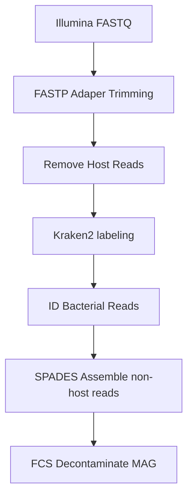

## Overview

This repository contains a Nextflow pipeline for processing Illumina sequencing data to assemble bacterial metagenome assembled genomes (MAGs) from samples with high host contamination. 

---



## Pipeline Summary
The nextflow pipeline performs the following steps:

1. **Adapter trimming**
   Remove adapters and low-quality reads
   
2. **Host Read Removal**  
   Align reads to the host genome and remove host-derived sequences.

3. **Bacterial identification (Kraken2)**  
   Classify bacterial reads using Kraken2. This is mostly to get a sense of taxonomic diversity within the sample (In my script I use the k2_standard DB: https://benlangmead.github.io/aws-indexes/k2)

4. **Genome Assembly**  
   Assemble the non-host reads with SPADES. In this version of the pipeline, we use assemble all the non-host reads, not kraken depleted reads. Though for a Eukaryote genome I would assemble the unidentified reads.

## Additional Scripts ##
There are additional scripts to further polish/assess the genome assembly. 

1. **Index the host genome wit BWA index**
Critical and required for host decontam. It's not currently part of the nextflow pipeline, as I usually run this step while I wait for the sequencing data and it only needs to be ran once.
I consider this more of a 'prep-time' step.

2. **Download the fastq data**
Once the fastq data becomes available, you can download the fastq data using the 'rawdata_links.tsv' file.

3. **Decontaminate the MAG with FCS**
Foreign Contaminant Screen (FCS) to flag the genome for contaminants. You must provide the appropriate taxid for your target genome.

4. **Binning**
Binning the MAG if appropriate. Binning tools are currently not available in the singularity folder within HPC.

5. **Quality Assessment**
CheckM for assessing strain heterogeneity, genome completeness, and contamination

## Usage

Prep the host genome assembly for use in the pipeline
```
sbatch pipeline/00_index-host-genome.sh -d host -r GCF_051106095.1_PviZW2.1_genomic.fna.gz
```

| Flag | Required | Description |
|------|----------|-------------|
| `-d` | ✅ | directory containing host reference genome (e.g., `host`) |
| `-r` | ✅ | Host reference genome fasta file (.gz is acceptable) |


Download the FASTQ data using the `rawdata_links.tsv` file :
```
sbatch pipeline/01_download-fastq.sh -i rawdata_links.tsv -o fastq
```

| Flag | Required | Description |
|------|----------|-------------|
| `-i` | ✅ | rawdata file |
| `-o` | ✅ | destination folder for raw fastq data |

run the nextflow pipeline
```
sbatch nextflow_launcher.sh metadata.tsv GCF_051106095.1_PviZW2.1_genomic.fna.gz
```
| Required | Description |
|----------|-------------|
| ✅ | metadata file created from previous step |
| ✅ | host reference genome |

Screen the genome assembly for contam with FCS-GX. This is the tool that NCBI uses to screen reference genomes prior to acceptance

You will need to download the fcs databases. See the following instructions: 
```
https://github-wiki-see.page/m/ncbi/fcs/wiki/FCS-GX-quickstart
```

The script accepts the following command-line flags:

| Flag | Required | Description |
|------|----------|-------------|
| `-t` | ✅ | NCBI Taxonomy ID (e.g., `31969`) |
| `-i` | ✅ | Path to input directory containing the FASTA file |
| `-f` | ✅ | Name of the FASTA file (within input directory) |
| `-o` | ✅ | Path to output directory |
| `-d` | ✅ | Path to FCS-GX database |
| `-n` | ✅ | Name of output subdirectory (sample name) |

**Example**
```bash
sbatch pipeline/02_fcs-screen.sh \
  -t 31969 \
  -i /mnt/shared/project/spades \
  -f scaffolds.fasta \
  -o /mnt/shared/project/FCS_output \
  -d /mnt/shared/fcs_db \
  -n in5323_1
```
